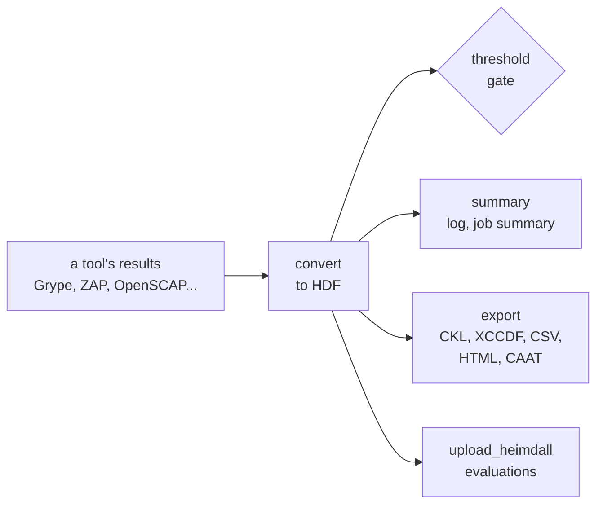

<div align="center">

# MITRE SAF CLI for CircleCI and GitHub Actions

### Turn your security tools' results into compliance gates, checklists and Heimdall evaluations, with a checksum-verified SAF CLI.

Install a checksum-verified [MITRE SAF CLI](https://saf-cli.mitre.org) and use it in a pipeline, as orb commands or GitHub Actions: convert 26 tools' results to the Heimdall Data Format (HDF), gate on compliance thresholds, summarize, export STIG Viewer checklists and reports, and upload to a [Heimdall](https://github.com/mitre/heimdall2) server.<br>
A gate that fails when the SAF CLI does, though it exits 0 · Thresholds checked as written · No Node.js needed<br>
JUnit for test tabs · Run records · API keys never on a command line · No `sudo`

[](https://circleci.com/gh/juburr/saf-orb)
[](https://github.com/juburr/saf-orb/actions/workflows/actions.yml)
[](https://circleci.com/developer/orbs/orb/juburr/saf-orb)
[](LICENSE)
[](https://discuss.circleci.com/c/ecosystem/orbs)


**[Quick Start](#-quick-start)** · **[Features](#-why-saf-orb)** · **[Recipes](#-recipes)** · **[Commands](#-commands)** · **[GitHub Actions](#-github-actions)** · **[Security](#-secure-by-design)** · **[Network Access](#-network-access)**

<sub>An unofficial, community-maintained CircleCI orb and set of GitHub Actions, not affiliated with MITRE. [Contributions are welcome!](#-contributing)</sub>

</div>

<br>

## ✨ Why saf-orb?

<table>
<tr>
<td width="33%" valign="top">
🚦 <b>A gate that fails when the SAF CLI does</b><br><br>
Most SAF CLI commands print a warning and exit 0 when they fail: a converter given the wrong file writes nothing, and a threshold check whose template is missing passes. Each step here checks what the SAF CLI wrote, and fails on a warning, a missing file or one that isn't HDF.
</td>
<td width="33%" valign="top">
🎯 <b>Thresholds checked as written</b><br><br>
<code>validate threshold</code> skips keys it doesn't know (a typo passes), loses a <code>min</code> when a <code>max</code> follows it in dotted form, and never checks <code>no_impact.total.max</code>, though <code>saf generate threshold</code> writes it. <code>threshold</code> reads the template first, refuses what would be skipped, and checks the rest itself.
</td>
<td width="33%" valign="top">
📦 <b>A verified SAF CLI with its own Node.js</b><br><br>
<code>install</code> unpacks the SAF CLI's Debian package, checked against this orb's SHA-512 table, without root or dpkg. It brings the official Node.js it was built for, so <code>cimg/base</code> works, and the update check that asks npm for a newer release once a day is off.
</td>
</tr>
<tr>
<td width="33%" valign="top">
🔄 <b>26 tools to HDF</b><br><br>
Grype, Trivy, ZAP, Nessus, Checkov, gosec, OpenSCAP and SCC (XCCDF results), STIG Viewer checklists, CycloneDX SBOMs, any SARIF and more. A converter that writes a file per host gets each a name of its own, and the next steps find them all in <code>SAF_HDF_FILES</code>.
</td>
<td width="33%" valign="top">
📋 <b>Checklists and reports</b><br><br>
<code>export</code> writes STIG Viewer checklists (CKL) with the asset's details, XCCDF results, CSV, an HTML report for executives, managers or administrators, and CAAT spreadsheets. <code>summary</code> puts a compliance table in the log and GitHub's job summary.
</td>
<td width="33%" valign="top">
🛰️ <b>Straight to Heimdall</b><br><br>
<code>upload_heimdall</code> sends each HDF file to a Heimdall server as an evaluation, with tags and groups, and exports its link. Every file is checked to be HDF first, the API key reaches curl in a file, never on its command line, and an upload is never retried, so nothing is stored twice.
</td>
</tr>
</table>

### 🧩 The Orb vs. a Hand-Rolled Script

| | Hand-rolled | saf-orb |
|---|---|---|
| Installing the SAF CLI | `npm install -g @mitre/saf` with whatever Node.js the image has, or an unpinned Docker image | the release's package, SHA-512 verified, cached, mirrored if you like; no Node.js needed |
| A converter given the wrong file | prints a warning, writes nothing, exits 0 | fails the step |
| A typo in a threshold template | skipped; the check passes | refused |
| `failed.total.min` and `failed.total.max` in dotted form | only the last one is checked | both |
| `no_impact.total.max`, as `saf generate threshold` writes it | never checked | checked |
| A threshold check that can't read its file | warns, exits 0 | fails the step |
| `saf-cli.log` | written into your checkout | kept in the step's own directory |
| Daily update check | asks npm for a newer release | off |
| Heimdall upload | `curl -H "Authorization: Api-Key $KEY"`, the key on the command line | key in a header file, HDF checked first, never retried |

## 🔄 How It Works



1. **`install`** puts a verified SAF CLI on the `PATH`.
2. **`convert`** turns a tool's results into HDF, checks what it wrote, and exports the files' paths in `SAF_HDF_FILES`.
3. **`threshold`**, **`summary`**, **`export`** and **`upload_heimdall`** read those files, or the ones you name.

## 🚀 Quick Start

### CircleCI

```yaml
version: 2.1

orbs:
  saf: juburr/saf-orb@0.1.0

jobs:
  scan:
    docker:
      - image: cimg/base:current
    steps:
      - checkout
      - run:
          name: Scan with Grype
          command: grype dir:. -o json > grype.json
      - saf/install
      - saf/convert:
          from: anchoregrype
          input: grype.json
      - saf/summary
      - saf/threshold:
          template_inline: "{failed.critical.max: 0}, {failed.high.max: 0}"

workflows:
  scan:
    jobs:
      - scan
```

Each vulnerability Grype found is a failed control in the HDF, by severity; the summary prints the counts, and the step fails if there is a critical or high one. The HDF, summary and threshold report are stored in the job's artifacts under `saf-reports/`, and the threshold check in its Tests tab.

### GitHub Actions

```yaml
jobs:
  scan:
    runs-on: ubuntu-24.04
    steps:
      - uses: actions/checkout@v7
        with:
          persist-credentials: false
      - name: Scan with Grype
        run: grype dir:. -o json > grype.json
      - uses: juburr/saf-orb/actions/install@v0.1.0
      - uses: juburr/saf-orb/actions/convert@v0.1.0
        with:
          from: anchoregrype
          input: grype.json
      - uses: juburr/saf-orb/actions/summary@v0.1.0
      - uses: juburr/saf-orb/actions/threshold@v0.1.0
        with:
          template_inline: "{failed.critical.max: 0}, {failed.high.max: 0}"
```

The summary also goes to the job's summary page.

## 🍳 Recipes

### Use a Template From `saf generate threshold`

Run `saf generate threshold -i baseline.json -o threshold.yml` once on results you accept, commit the template, and check every build against it:

```yaml
- saf/threshold:
    template_file: compliance/threshold.yml
```

Templates are YAML, nested or dotted (`failed.critical.max: 0`), with control lists such as `failed.critical.controls: [V-230221]`. The keys are `compliance.min` and `.max` (percent), `<status>.total` (an exact count), `<status>.total.min` and `.max`, and `<status>.<severity>.min`, `.max` and `.controls`, for the statuses `passed`, `failed`, `skipped` (not reviewed), `no_impact` (not applicable) and `error`, and the severities `critical`, `high`, `medium`, `low` (and `none` for `no_impact`). Anything else fails the step, since the SAF CLI would skip it.

### A STIG Checklist for an Assessor

```yaml
- saf/convert:
    from: xccdf_results
    input: results.xml
    report_name: rhel9
- saf/export:
    format: ckl
    extra_args: --hostname web01 --fqdn web01.example.com --role "Member Server"
```

`--metadata` takes a file from `saf generate ckl_metadata` with every asset and STIG field at once.

### Several Hosts or Projects

Nessus and Snyk results with several hosts or projects become one HDF file each, `<report_name>-<host>.json`, and `SAF_HDF_FILES` lists them all, so `threshold` checks each and `summary` adds them up.

### Upload to Heimdall

```yaml
- saf/upload_heimdall:
    url: https://heimdall.example.com
    evaluation_tags: ${CIRCLE_BRANCH},build ${CIRCLE_BUILD_NUM}
```

with `HEIMDALL_API_KEY` in a context. The server's administrator turns API keys on by setting `API_KEY_SECRET`; each user makes keys in their settings. A server with a private CA works with `CURL_CA_BUNDLE` set to its certificate.

### TruffleHog Results

`convert` leaves out the SAF CLI's `trufflehog2hdf`, which copies every secret TruffleHog found, in full, into the HDF. Convert TruffleHog's SARIF instead (with [trufflehog-orb](https://github.com/juburr/trufflehog-orb), its reports never hold the secrets):

```yaml
- saf/convert:
    from: sarif
    input: /tmp/trufflehog-reports/trufflehog.sarif
    report_name: secrets
```

### Keep a Run Record

`threshold` with `run_record: true` writes `<report_name>.run-record.json`: the SAF CLI that ran (path, version, and the package it was installed from with its SHA-512), the files checked with their SHA-256, the thresholds and each verdict, as [`schemas/run-record.v1.json`](schemas/run-record.v1.json) describes.

## 🧰 Commands

| Command | What it does |
|---|---|
| [`install`](#safinstall) | Installs the SAF CLI, verified against this orb's checksum table |
| [`convert`](#safconvert) | Converts a tool's results to HDF, and exports the files' paths |
| [`threshold`](#safthreshold) | Checks HDF results against compliance thresholds, and gates on them |
| [`summary`](#safsummary) | Summarizes HDF results: compliance and counts by status and severity |
| [`export`](#safexport) | Exports HDF results as a checklist, XCCDF, CSV, HTML or CAAT |
| [`upload_heimdall`](#safupload_heimdall) | Uploads HDF results to a Heimdall server |

Every parameter that names a value expands environment variables, except `output_dir` and `report_name`, which the steps that store the reports read too, and a leading `~` in a file's path is the home directory. A step never clears a report of an earlier run that is a file it reads: it fails instead, asking for another `report_name`. Every command that reads HDF takes `input`: paths or globs, separated by commas, spaces or newlines; empty takes the files the last `convert` wrote, from `SAF_HDF_FILES`.

### `saf/install`

| Parameter | Default | Description |
|---|---|---|
| `version` | `1.7.0` | The SAF CLI release to install. |
| `verify_checksums` | `strict` | `strict` refuses a release the table doesn't list, before downloading; `known_versions` installs it unverified, with a warning; `false` verifies nothing. |
| `install_path` | `$HOME/.saf-orb` | The installation's root; its `bin`, which holds only the `saf` launcher, goes on the `PATH` of later steps. |
| `caching` | `true` | Cache the verified release between jobs. |
| `download_base_url` | | An `https://` mirror of GitHub Releases, such as Artifactory. The table still decides what is installed. |

### `saf/convert`

| Parameter | Default | Description |
|---|---|---|
| `from` | | The tool: `anchoregrype` (Grype), `asff`, `burpsuite`, `checkov`, `ckl`, `conveyor`, `cyclonedx_sbom`, `dbprotect`, `dependency_track`, `fortify`, `gosec`, `jfrog_xray`, `nessus`, `netsparker`, `neuvector`, `nikto`, `prisma`, `prowler`, `sarif`, `scoutsuite`, `snyk`, `trivy` (its ASFF output), `twistlock`, `veracode`, `xccdf_results` (OpenSCAP, SCC) or `zap`. |
| `input` | | The tool's results file. |
| `include_raw` | `false` | Add the tool's results to the HDF (`-w`), for the converters that take it. |
| `extra_args` | | The converter's own options: `zap` needs `--name <site>`; `nessus` takes `--parser`; `asff` takes `--securityHub <file>`. |
| `output_dir` | `/tmp/saf-reports` | Where the HDF goes. |
| `report_name` | `from` | `<report_name>.json`, or `<report_name>-<name>.json` for each when the converter writes several. |
| `hdf_env_var` | `SAF_HDF_FILES` | The variable to export the files' paths in, one per line. |
| `store_artifacts` | `true` | Store `output_dir` as artifacts. |

### `saf/threshold`

| Parameter | Default | Description |
|---|---|---|
| `input` | | The HDF files, each checked on its own. |
| `template_file` | | A threshold template (YAML). |
| `template_inline` | | Thresholds in the SAF CLI's inline form: `{compliance.min: 80}, {failed.critical.max: 0}`. |
| `output_dir` | `/tmp/saf-reports` | Where the reports go. |
| `report_name` | `threshold` | What the reports are called. |
| `junit` | `true` | Write and store `junit/<report_name>.xml`, a test per file. |
| `run_record` | `false` | Write `<report_name>.run-record.json`. |
| `report_only` | `false` | Pass with a warning when a file doesn't meet the thresholds. |
| `store_artifacts` | `true` | Store `output_dir` as artifacts. |

`<report_name>.json` holds the thresholds and, for each file, its profile, verdict, the first threshold it didn't meet, its compliance and its counts by status and severity. A file the SAF CLI can't check fails the step whatever `report_only` says. The SAF CLI checks only the first profile of a file (one without a `parent_profile`), and the step warns when there are others.

### `saf/summary`

| Parameter | Default | Description |
|---|---|---|
| `input` | | The HDF files; those whose first profile has the same name are added up. |
| `formats` | `json markdown` | What to write: `json`, `yaml` and `markdown`. |
| `step_summary` | `true` | On GitHub Actions, add the table to the job's summary page. |
| `output_dir` | `/tmp/saf-reports` | Where the summary goes. |
| `report_name` | `summary` | What its files are called. |
| `store_artifacts` | `true` | Store `output_dir` as artifacts. |

### `saf/export`

| Parameter | Default | Description |
|---|---|---|
| `input` | | The HDF files. |
| `format` | | `ckl`, `xccdf` and `csv` write a file per HDF file (`.ckl`, `.xml`, `.csv`); `html` and `caat` one for them all (`.html`, `.xlsx`). |
| `extra_args` | | The format's options. `ckl`: `--metadata`, `--hostname`, `--ip`, `--mac`, `--fqdn`, `--role`, `--assettype`, `--techarea`, `--marking`, `--targetcomment`, `--targetkey`, `--stigguid`, `--webordatabase`, `--webdbsite`, `--webdbinstance`, `--profilename`, `--profiletitle`, `--version`, `--releasenumber`, `--releasedate`, `--vulidmapping`. `csv`: `--fields`, `--noTruncate`. `html`: `--type Executive`, `Manager` or `Administrator`. |
| `output_dir` | `/tmp/saf-reports` | Where the exports go. |
| `report_name` | | The exports' name. Empty: each HDF file's (`results.json` gives `results.ckl`). |
| `store_artifacts` | `true` | Store `output_dir` as artifacts. |

### `saf/upload_heimdall`

| Parameter | Default | Description |
|---|---|---|
| `url` | | The Heimdall server: `https://`, or `http://` to `localhost`. |
| `api_key` | `HEIMDALL_API_KEY` | The variable holding an API key. |
| `input` | | The HDF files, an evaluation each. |
| `public` | `false` | Make the evaluations readable by every user. |
| `evaluation_tags` | | Tags, separated by commas or newlines. |
| `groups` | | IDs of groups to add the evaluations to. |
| `timeout` | `600` | Seconds each request may take. |
| `evaluation_urls_env_var` | `HEIMDALL_EVALUATION_URLS` | The variable to export the evaluations' links in. |
| `output_dir` | `/tmp/saf-reports` | Where `<report_name>.json`, the list of evaluations, goes. |
| `report_name` | `heimdall` | The list's name. |
| `store_artifacts` | `true` | Store `output_dir` as artifacts. |

## ⚡ GitHub Actions

Every command has a composite action of the same name, with the same inputs and defaults, running the same scripts:

| Action | Command |
|---|---|
| `juburr/saf-orb/actions/install@v0.1.0` | `install` |
| `juburr/saf-orb/actions/convert@v0.1.0` | `convert` |
| `juburr/saf-orb/actions/threshold@v0.1.0` | `threshold` |
| `juburr/saf-orb/actions/summary@v0.1.0` | `summary` |
| `juburr/saf-orb/actions/export@v0.1.0` | `export` |
| `juburr/saf-orb/actions/upload_heimdall@v0.1.0` | `upload_heimdall` |

What one action exports, later steps see, as with CircleCI's `BASH_ENV`, so `SAF_HDF_FILES` reaches the actions after `convert`. A few differences:

- **Quote booleans and numbers** in `with:` (`report_only: "true"`), since every input is a string.
- **Environment variables aren't expanded in inputs.** Use `${{ env.NAME }}` instead.
- **The API key** goes in the `env` of the step that uses `upload_heimdall`, from a secret: `env: HEIMDALL_API_KEY: ${{ secrets.HEIMDALL_API_KEY }}`.
- **Reports are uploaded as artifacts** named `saf-reports-<report_name>-<random>`.
- **Pin the actions to a commit SHA** for the strongest guarantee: `juburr/saf-orb/actions/threshold@<sha> # v0.1.0`.

## 🔒 Secure by Design

- **Verified installs.** The SAF CLI's package is checked against this orb's SHA-512 table before it is unpacked, and a cached copy is checked again. Each table entry was checked file by file against what MITRE signed (see [Checksum Verification](#-checksum-verification)).
- **No update check.** The launcher sets `SAF_SKIP_NEW_VERSION_CHECK=true`, which stops the SAF CLI asking npm for a newer release once a day.
- **The API key stays off command lines.** `upload_heimdall` reads it from the variable `api_key` names, with tracing off, writes the header to a file in its own `mktemp` directory, and passes curl that file. It sends the key only over `https://`, or `http://` to `localhost` (never through a proxy), and only after Heimdall says it takes API keys.
- **No secrets copied into HDF.** `convert` leaves out `trufflehog2hdf`, which would put each secret TruffleHog found into the HDF, and the converters that take credentials on their command line.
- **Nothing written to your checkout.** The SAF CLI runs in the step's own directory, where its `saf-cli.log` stays.
- **Nothing executed from parameters.** Templates are read, never run; `extra_args` is split like shell words, with nothing expanded or run, and only each converter's or format's own options are accepted.
- **No `sudo`.** Everything installs and caches under `HOME`; the package is unpacked, never installed with dpkg.

## 💻 Supported Platforms

- **Executors.** Linux on amd64 or arm64, with bash 4, curl or wget, tar, jq, and `dpkg-deb` or `ar` with `zstd` or `xz`: `cimg/base`, CircleCI's machine images, and GitHub's Ubuntu runners. No Node.js is needed.
- **SAF CLI.** 1.7.0 (the default, with Node.js 22) and 1.5.3 (with Node.js 20, past its end of life). 1.5.3 has no `checkov` converter and no `html` export. CI tests 1.7.0 on both architectures, and 1.5.3's install.

## 🔐 Checksum Verification

`install.sh` holds the SHA-512 of the SAF CLI's Debian packages for Linux amd64 and arm64, for **1.7.0** and **1.5.3**. The packages carry no signature of their own, so each entry was added only after `src/scripts/install_hash.sh` checked the package against what is signed:

1. **The npm package** `@mitre/saf` of that version: its registry signature and SLSA provenance (`npm audit signatures`), and that the provenance names `mitre/saf`'s release workflow, the release's tag (or a branch at the commit the tag points to), and a commit.
2. **The package's files are the npm package's**, the lockfile is the one at that commit, and every file under `node_modules` is in the npm tarball of the version the lockfile pins, with the integrity hash it pins. Every package the lockfile installs is there, and nothing else is: no other files, and no links but npm's own.
3. **Its `node` is the official Node.js build**, whose `SHASUMS256.txt` is signed by a Node.js release key.
4. **The release was at least 7 days old**, so a compromise had time to come to light.

1.6.0 is left out: npm's 1.6.0 was built from a commit its tag doesn't point to, so its packages can't be tied to it.

| Mode | Listed version | Unlisted version |
|---|---|---|
| `strict` (default) | verified | fails before downloading anything |
| `known_versions` | verified | installed **unverified**, with a warning |
| `false` | not verified | not verified |

## 🌐 Network Access

| Host | When |
|---|---|
| `github.com` (and its release asset hosts) | `install`, unless `download_base_url` names a mirror, or the release comes from the cache |
| The Heimdall server you name | `upload_heimdall` |

`convert`, `threshold`, `summary` and `export` make no network calls: the converters this orb runs read files, and the update check is off.

## 🗺️ Not Yet Included

- **Converters that read a service** (SonarQube, Splunk, AWS Config, AWS Security Hub, Microsoft Secure Score, Ion Channel), which take credentials on the SAF CLI's command line. Run them with the SAF CLI directly after `install`.
- **The SAF CLI's other commands**: eMASS, `attest`, `supplement`, `generate` and `harden`.
- **Heimdall groups by name**: Heimdall looks them up only for a logged-in user, so `groups` takes IDs.
- **macOS and Windows executors.**

## 🤝 Contributing

```bash
# Lint
yamllint .
shellcheck src/scripts/*.sh src/scripts/lib/*.sh actions/*.sh tests/*.sh

# Offline tests (jq, curl, python3, and jsonschema for the run record schema)
for t in tests/*_test.sh; do bash "$t" || break; done

# Pack and validate
circleci orb pack src/ > orb.yml && circleci orb validate orb.yml

# Table entries for a new SAF CLI release (npm, python3, gpgv, jq, xz, git)
./src/scripts/install_hash.sh -v <version>
```

Pull requests run the offline tests, then every command with the real SAF CLI on its own sample data on CircleCI (`.circleci/test-deploy.yml`) and every action on GitHub's runners (`.github/workflows/actions.yml`), including uploads to a Heimdall server in Docker.

## 📜 License

[MIT](LICENSE). The orb downloads the SAF CLI's official releases, which are licensed under the [Apache License 2.0](https://github.com/mitre/saf/blob/main/LICENSE.md), and runs them unmodified; it holds none of the SAF CLI's code. MITRE SAF and Heimdall are MITRE's; this project is not affiliated with MITRE.
